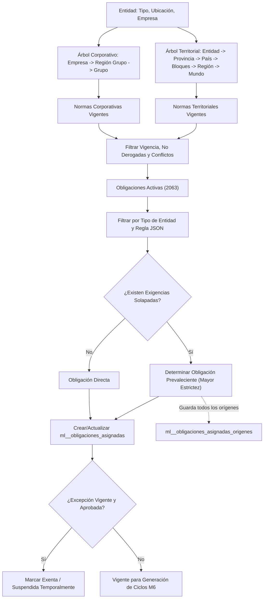

# Diseño M5: Motor de Herencia y Solapamientos — Módulo Matriz Legal

**Fecha:** 2026-10-03  
**Agente responsable:** `disenador-proceso`  
**Módulo ERP:** Módulo 3 (`ml`)  
**Palabra clave de habilitación:** **GRANDE**  
**Fuentes:** [01-logica-del-proceso.md](file:///c:/xampp/htdocs/casalucho/docs/matriz-legal/01-logica-del-proceso.md) (Sección 4 "Qué normas aplican a cada entidad" y Sección 6 "Vida de una norma"), [02-casos-de-aceptacion.md](file:///c:/xampp/htdocs/casalucho/docs/matriz-legal/02-casos-de-aceptacion.md) (Casos C01, C05, C06, C08, C09, C11, C13, C19, C20, C25, C35) y [04-modelo-de-datos.dbml](file:///c:/xampp/htdocs/casalucho/docs/matriz-legal/04-modelo-de-datos.dbml) (tablas 48 a 51).

---

## 1. Alcance y Objetivos de M5

El **Motor de Herencia** es el núcleo de cálculo automático del módulo de Matriz Legal. Resuelve la asignación dinámica de normas y exigencias sin intervención manual entidad por entidad:
- **Ninguna norma u obligación se asigna manualmente a una entidad**: se heredan a partir del cruce de dos árboles jerárquicos independientes (**Territorio** y **Estructura Corporativa**) que convergen en la entidad y su empresa.
- **Consolidación de Solapamientos**: Cuando dos niveles exigen lo mismo (ej: estándar mundial ISO + ley nacional + política corporativa), se genera **una sola obligación asignada** con la exigencia más estricta (prevaleciente), preservando todos los orígenes para auditoría inmutable.
- **Excepciones Temporales**: Gestión de excepciones justificadas (motivo, fundamento y aprobación legal obligatoria para normas legales) con vigencia temporal estricta (al vencer, la exigencia vuelve a regir de pleno derecho).
- **Cola de Recálculos**: La regla dorada del proceso: *"Lo futuro se recalcula, lo pasado no se toca"*. Cualquier cambio en la estructura, datos o normas encola un recálculo sin alterar ciclos ni tareas cerradas.

### Tablas Comprendidas (M0 / DBML 48 a 51):
1. **`ml__obligaciones_asignadas` (248)**: Obligación asignada a una entidad resultante del motor de herencia. De ella colgarán los ciclos operativos en M6.
2. **`ml__obligaciones_asignadas_origenes` (249)**: Trazabilidad completa de todas las obligaciones normativas que convergen y originan la obligación asignada.
3. **`ml__excepciones` (250)**: Registro de excepciones temporales con proceso de aprobación legal y regional (Estados 2087 a 2091).
4. **`ml__recalculos_pendientes` (251)**: Cola asíncrona de procesamiento para recálculos tras eventos normativos, corporativos o territoriales (Estados 2092 a 2094).

---

## 2. Casos de Aceptación Cubiertos por M5

| Caso | Escenario | Tratamiento en el Motor |
|:---:|---|---|
| **C01** | País con pertenencia a dos bloques regionales | Hereda normas de ambos bloques; consolida solapamientos si exigen lo mismo y reporta por pertenencia principal. |
| **C05** | Entidad cambia de país a mitad de ciclo | Cierra asignación anterior en la fecha de cambio y genera asignaciones nuevas en el país destino. |
| **C06** | Entidad móvil opera en varios países | Aplican normas de la base + normas de cada país de operación declarado (`ml__entidades_operacion_paises`). |
| **C08** | Jerarquía de entidades (Tanque en Terminal) | Cada entidad recibe únicamente las obligaciones de su tipo. La jerarquía agrupa y consolida datos, no hereda obligaciones. |
| **C09** | Excepción con fecha de vencimiento | Suspende la exigencia temporalmente; si es legal requiere dictamen legal; al vencer la fecha vuelve a regir. |
| **C11** | Política de empresa más estricta que la ley | Prevalece la política corporativa más estricta; la empresa nunca puede relajar la ley (Caso C11). |
| **C13** | País cambia de subregión | Registra fecha de efecto y recalcula asignaciones futuras. |
| **C19** | Normas incompatibles detectadas | Se bloquea la consolidación y se alerta el conflicto normativo escalado a legales (`ml__normas_conflictos`). |
| **C20** | Aplicación gradual por condiciones JSON | Evalúa reglas JSON contra atributos de la entidad (`ml__entidades_datos`) o empresa (`ml__empresas_datos`). |
| **C25** | Empresa cruza umbral a mitad de período | Encola recálculo de aplicabilidad y activa nuevas obligaciones desde la fecha del dato. |
| **C35** | Cambio masivo en norma mundial | Permite simulación y vista previa de impacto antes de confirmar el lote de recálculo masivo. |

---

## 3. Algoritmo del Motor de Herencia

### Criterio de Prevalencia (Mayor Estrictez):
1. **Regla base:** La política corporativa puede elevar el estándar de la ley, pero una norma corporativa nunca puede rebajar una exigencia legal.
2. **Ponderación:**
   - Mayor peso de criticidad (`ml__criticidades.peso`).
   - Mayor frecuencia / menor intervalo (`ml__periodicidades.intervalo_cantidad`).
   - Mayor plazo de retención de evidencias (`retencion_evidencias_meses`).
   - Exigencia de evidencia y revisión técnica obligatoria.

---

## 4. Mapa de Pantallas (`conf__paginas`)

Agrupador de menú de nivel superior:
- **(331) Motor y Asignaciones** (`url = '#'`) — `padre_id = 0`, `orden = 40`.
  - **(332) Obligaciones Asignadas** (`url = 'obligaciones_asignadas.php'`) — `padre_id = 331`, `orden = 10`, `tabla_id = 248`.
    *Matriz viva de obligaciones heredadas por entidad y empresa, trazabilidad de orígenes consolidados y estado de vigencia.*
  - **(333) Excepciones de Cumplimiento** (`url = 'excepciones.php'`) — `padre_id = 331`, `orden = 20`, `tabla_id = 250`.
    *Gestión del ciclo de vida de excepciones (2087 Solicitada -> 2088 Legal -> 2089 Aprobada -> 2090/2091 Finales).*
  - **(334) Motor de Herencia y Recálculos** (`url = 'recalculos_motor.php'`) — `padre_id = 331`, `orden = 30`, `tabla_id = 251`.
    *Consola del motor: simulación de impacto masivo (C35), recálculo manual por entidad/empresa y monitor de la cola asíncrona.*

---

## 5. Funciones y Permisos (`conf__paginas_funciones`)

Bloque **3151 a 3180**:
| ID | Página | Función | `accion_js` | Estado Origen | Estado Destino | Perfiles |
|:---:|:---:|---|---|:---:|:---:|---|
| **3151** | 332 | Consultar Obligaciones Asignadas | `consultar_obligaciones_asignadas` | 0 | 1 | 301, 302, 303, 304, 305 |
| **3152** | 332 | Desactivar / Suspender Asignación | `desactivar_obligacion_asignada` | 1 | 2 | 301, 302, 303 |
| **3161** | 333 | Solicitar Excepción | `solicitar_excepcion` | 0 | 2087 | 301, 302, 303, 304 |
| **3162** | 333 | Escalar a Aprobación Legal | `enviar_aprobacion_legal_excepcion` | 2087 | 2088 | 301, 302 |
| **3163** | 333 | Aprobar Excepción | `aprobar_excepcion` | 2088 | 2089 | 301, 303 (Legal) |
| **3164** | 333 | Rechazar Excepción | `rechazar_excepcion` | 2088 | 2090 | 301, 303 (Legal) |
| **3165** | 333 | Revocar Excepción Vigente | `revocar_excepcion` | 2089 | 2091 | 301, 303 (Legal) |
| **3171** | 334 | Ejecutar Recálculo del Motor | `ejecutar_recalculo_motor` | 0 | 1 | 301, 302 |
| **3172** | 334 | Simular Impacto de Cambios | `simular_impacto_motor` | 0 | 1 | 301, 302 |
| **3173** | 334 | Procesar Cola de Recálculos | `procesar_cola_recalculos` | 2092 | 2093 | 301, 302 |

---

## 6. Convenciones de UI y Estándar del Proyecto
- **DataTables:** `pageLength: 10`, selector de registros abajo a la izquierda (`li`), búsqueda responsive (`f`).
- **Botones:** Formato `btn-group-sm` icon-only con tooltips descriptivos.
- **Transiciones de estado:** Validaciones estrictas de perfil (Legal requerido si la norma es de tipo legal `es_legal = 1`).
