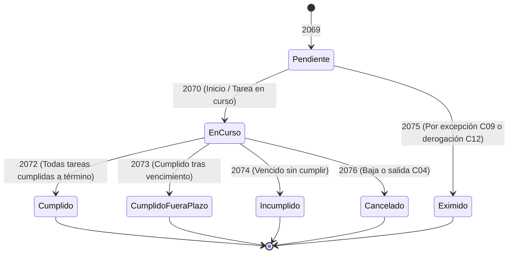
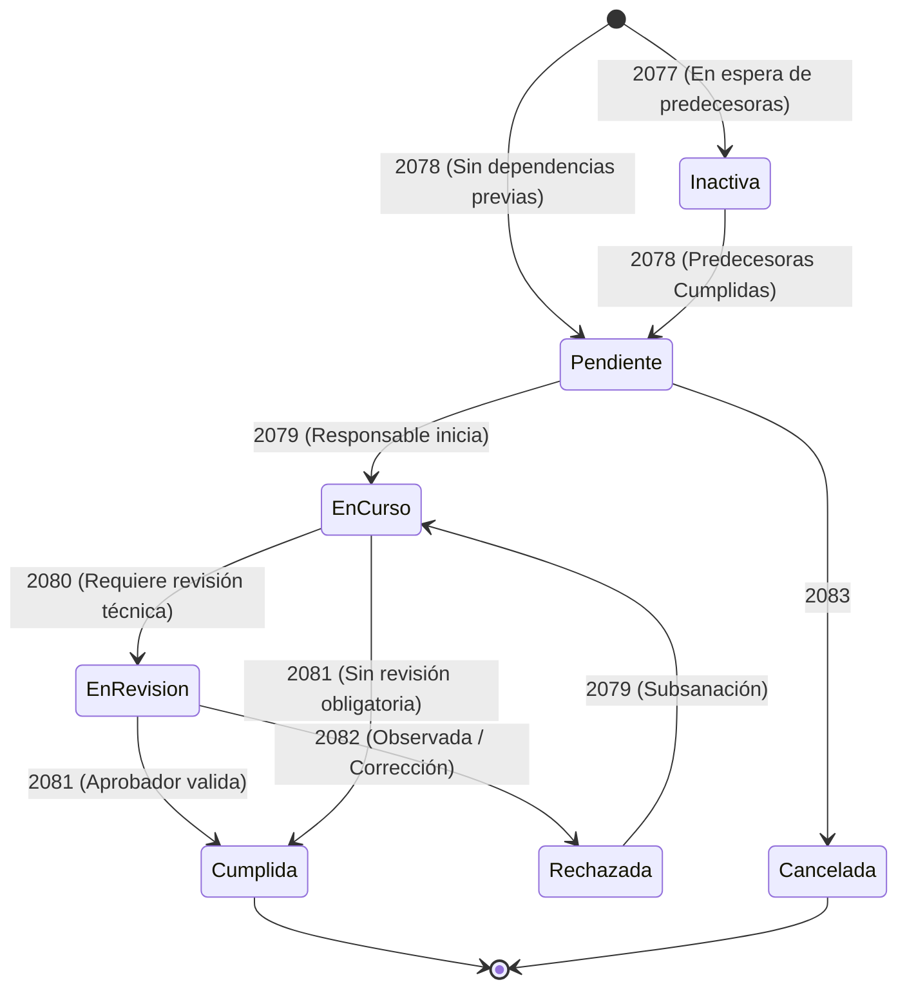

# Diseño M6: Ciclos y Tareas — Módulo Matriz Legal

**Fecha:** 2026-10-03  
**Agente responsable:** `disenador-proceso`  
**Módulo ERP:** Módulo 3 (`ml`)  
**Fuentes:** [01-logica-del-proceso.md](file:///c:/xampp/htdocs/casalucho/docs/matriz-legal/01-logica-del-proceso.md) (Sección 5 "Del requisito a la ejecución"), [02-casos-de-aceptacion.md](file:///c:/xampp/htdocs/casalucho/docs/matriz-legal/02-casos-de-aceptacion.md) (Casos C02 a C05, C07, C10, C12, C14, C16, C22 a C25, C28 a C31) y [04-modelo-de-datos.dbml](file:///c:/xampp/htdocs/casalucho/docs/matriz-legal/04-modelo-de-datos.dbml) (tablas 52 a 59).

---

## 1. Alcance y Objetivos de M6

El **Ciclo** es la **unidad auditable** del sistema. No se edita históricamente: cada período es una instancia nueva e inmutable en su génesis que conserva la norma, la versión de documentos y los responsables que actuaron.

### Principios Fundamentales del Proceso:
1. **Generación Continua a 12 Meses**: Las obligaciones repetitivas proyectan sus ciclos en una ventana móvil de doce meses hacia adelante.
2. **Ciclos por Evento ([Caso C07](file:///c:/xampp/htdocs/casalucho/docs/matriz-legal/02-casos-de-aceptacion.md#L47-L52))**: Ocurrencias no periódicas (derrames, inspecciones, incidentes) generan un ciclo instantáneo cuyo vencimiento se mide en horas o días desde el suceso, computado en el huso horario local de la entidad ([Caso C31](file:///c:/xampp/htdocs/casalucho/docs/matriz-legal/02-casos-de-aceptacion.md#L198-L203)).
3. **Instanciación Operativa de Tareas**: La norma nunca genera tareas directamente; cada ciclo crea sus tareas a partir de las plantillas de la obligación (`ml__tareas_plantillas`).
4. **Secuenciamiento Dinámico**: Las tareas dependientes nacen como *Inactivas* (2077) y se activan a *Pendientes* (2078) en cascada una vez cumplidas sus predecesoras (2081).
5. **Calidad y Trazabilidad sin Ruptura**:
   - **Error en ciclo cerrado ([Caso C28](file:///c:/xampp/htdocs/casalucho/docs/matriz-legal/02-casos-de-aceptacion.md#L180-L185))**: Se crea un ciclo complementario enlazado (`COMPLEMENTARIO`), manteniendo el original intacto.
   - **Hallazgo de auditoría ([Caso C29](file:///c:/xampp/htdocs/casalucho/docs/matriz-legal/02-casos-de-aceptacion.md#L186-L191))**: Se abre un ciclo de seguimiento (`SEGUIMIENTO`) con su propio plan de acción.
   - **Reasignación en Bloque ([Caso C27](file:///c:/xampp/htdocs/casalucho/docs/matriz-legal/02-casos-de-aceptacion.md#L174-L179))**: Traspaso automático de tareas asignadas cuando un responsable deja la empresa o cambia de rol.

---

## 2. Tablas Comprendidas (M0 / DBML 52 a 59)

1. **`ml__ciclos_vinculos_tipos` (252)**: Catálogo de tipología de enlaces (`COMPLEMENTARIO`, `SEGUIMIENTO`, `RENOVACION`).
2. **`ml__ciclos` (253)**: Períodos operativos concretos con fechas de inicio, vencimiento y cierre.
3. **`ml__ciclos_tareas` (254)**: Actividades operativas instanciadas en cada ciclo.
4. **`ml__ciclos_tareas_dependencias` (255)**: Grafo dinámico de dependencias entre tareas del ciclo.
5. **`ml__obligaciones_asignadas_raci` (256)**: Plantilla RACI configurada a nivel de obligación asignada.
6. **`ml__ciclos_raci` (257)**: Responsables asignados al ciclo completo.
7. **`ml__ciclos_tareas_raci` (258)**: Responsables asignados a nivel de tarea individual.
8. **`ml__reasignaciones` (259)**: Registro histórico de traspasos de tareas entre usuarios.

---

## 3. Flujo de Estados

### Ciclos de Cumplimiento (`tabla_id = 253`):

### Tareas del Ciclo (`tabla_id = 254`):

---

## 4. Mapa de Pantallas (`conf__paginas`)

Agrupador de menú de nivel superior:
- **(341) Ciclos y Tareas** (`url = '#'`) — `padre_id = 0`, `orden = 45`.
  - **(342) Calendario y Ciclos** (`url = 'ciclos.php'`) — `padre_id = 341`, `orden = 10`, `tabla_id = 253`.
    *Tablero de períodos de cumplimiento, estados de ciclo, control de prórrogas y vinculación de ciclos complementarios/seguimiento.*
  - **(343) Tareas Operativas** (`url = 'ciclos_tareas.php'`) — `padre_id = 341`, `orden = 20`, `tabla_id = 254`.
    *Bandeja de trabajo de tareas, avance secuencial con dependencias, revisión técnica y vinculación de instructivos M3.*
  - **(344) Matriz RACI y Asignaciones** (`url = 'ciclos_raci.php'`) — `padre_id = 341`, `orden = 30`, `tabla_id = 258`.
    *Asignación de roles RACI y reasignación masiva de responsables por salida o cambio de puesto (Caso C27).*
  - **(345) Generador y Eventos** (`url = 'ciclos_generador.php'`) — `padre_id = 341`, `orden = 40`.
    *Consola de generación a 12 meses y disparador de obligaciones por evento en horas con huso horario local (Casos C07 y C31).*

---

## 5. Funciones y Permisos (`conf__paginas_funciones`)

Bloque **3181 a 3220**:
| ID | Página | Función | `accion_js` | Estado Origen | Estado Destino | Perfiles |
|:---:|:---:|---|---|:---:|:---:|---|
| **3181** | 342 | Consultar Ciclos | `consultar_ciclos` | 0 | 1 | 301 a 305 |
| **3182** | 342 | Cerrar Ciclo | `cerrar_ciclo` | 2070 | 2072 | 301, 302, 303 |
| **3183** | 342 | Eximir Ciclo | `eximir_ciclo` | 2069 | 2075 | 301, 302, 303 |
| **3184** | 342 | Cancelar Ciclo | `cancelar_ciclo` | 2069 | 2076 | 301, 302, 303 |
| **3185** | 342 | Crear Ciclo Complementario | `crear_ciclo_complementario` | 2072 | 2069 | 301, 302, 303 |
| **3186** | 342 | Crear Ciclo Seguimiento | `crear_ciclo_seguimiento` | 2072 | 2069 | 301, 302, 303 |
| **3191** | 343 | Iniciar Tarea | `iniciar_tarea` | 2078 | 2079 | 301, 304, 305 |
| **3192** | 343 | Enviar Tarea a Revisión | `enviar_revision_tarea` | 2079 | 2080 | 301, 304, 305 |
| **3193** | 343 | Cumplir Tarea | `cumplir_tarea` | 2080 | 2081 | 301, 302, 303 |
| **3194** | 343 | Rechazar Tarea | `rechazar_tarea` | 2080 | 2082 | 301, 302, 303 |
| **3195** | 343 | Cancelar Tarea | `cancelar_tarea` | 2078 | 2083 | 301, 302 |
| **3201** | 344 | Guardar Asignación RACI | `guardar_raci` | 0 | 1 | 301, 302, 304 |
| **3202** | 344 | Reasignar Responsable Bloque | `reasignar_responsable_bloque` | 0 | 1 | 301, 302 |
| **3211** | 345 | Generar Ciclos Período | `generar_ciclos_periodo` | 0 | 1 | 301, 302 |
| **3212** | 345 | Disparar Obligación por Evento | `disparar_ciclo_evento` | 0 | 1 | 301, 302, 304 |
